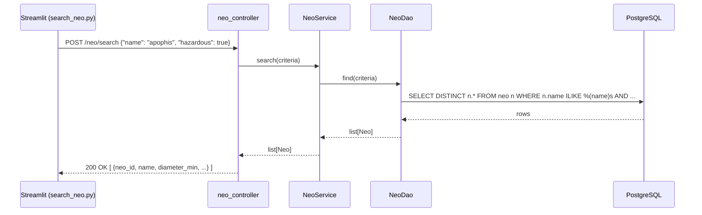

# NEO-Watch backend: developer guide

REST API built with [FastAPI](https://fastapi.tiangolo.com/). It imports the Near-Earth Objects
from the NASA NeoWs API, stores them in PostgreSQL and serves them to the Streamlit frontend.

How to install and configure the whole application (`.env`, SSP Cloud): see the
[README at the root](../README.md).

## 🚀 Run

From the repository root:

```bash
uv sync --project backend --all-extras
uv run --project backend python backend/src/main.py
```

- API documentation (Swagger): `http://localhost:5000/docs`
- On start, `main.run_init_db()` creates the tables (`data/init_db.sql`) and the seed data
  (`data/pop_db.sql`) if the schema is empty. On an existing database, it applies the schema
  fixes listed in `MIGRATIONS` instead: the data is kept.

## 🏛️ Architecture

The code is in `src/` and follows a **layered architecture**: each layer only calls the layer
below it.

| Layer | Folder | Role |
| --- | --- | --- |
| Controller | `controller/` | HTTP endpoints (FastAPI routers): validation, authentication, HTTP errors |
| Schema | `schema/` | Pydantic models of the API requests and responses |
| Service | `service/` | Business logic (rules, computations, NASA calls) |
| DAO | `dao/` | SQL queries, one class per table or feature |
| Business object | `business_object/` | Domain classes: `Neo`, `Approach`, `User`, `Alert`... |
| Utils | `utils/` | Security (JWT, passwords), logs, singleton, database reset |

Example: searching NEOs from the frontend.



### Main design choices

- **NASA import** (`service/import_service.py`): the `/feed` endpoint returns at most 7 days per
  call, so the period is split into windows. Each import is recorded in the `import` table with
  its status (`success`, `partial` when the quota ran out, `failed`), so the next one only fetches
  what is missing.
- **Automatic update, FO7** (`service/import_scheduler.py`): imports run in a background thread,
  one at a time. `DailyImportScheduler` starts one when the API starts, then every 24 h: it
  imports the missing days and, once a day, the next 30 days again (new discoveries). The admin
  button (`POST /import/update`) calls the same code. `AUTO_IMPORT=false` turns it off.
- **Notifications, F6** (`service/alert_service.py`): an approach is notified once. When an
  alert has matched, its `last_eval_date` is set (database clock), and only the approaches
  recorded after that date match it again.
- **Database connection** (`dao/db_connection.py`): one connection per thread, because FastAPI
  runs the endpoints in a thread pool and threads must not share a transaction.
- **Security** (`utils/security.py`): passwords are hashed with SHA-256 salted with the
  username; the API uses JWT access tokens (30 min) and refresh tokens (7 days), read from the
  `Authorization` or `X-Auth-Token` header only. An expired token is always refused. A user only
  reads and changes their own favourites and alerts (administrators excepted).
- **Units**: distances in km, diameters in km, speeds in km/h.

## 📡 Endpoints

All endpoints except `/login/` and `/login/register` need a token:
`Authorization: Bearer <access_token>`.

| Method | Path | Description |
| --- | --- | --- |
| POST | `/login/` | Log in, returns an access and a refresh token |
| POST | `/login/register` | Create an account |
| POST | `/login/refresh` | New access token from a refresh token |
| GET | `/login/me` | Profile of the logged-in user |
| GET | `/neo` | List the NEOs (pagination: `limit`, `offset`) |
| POST | `/neo/search` | Search with criteria (name, diameter, hazardous, origin, dates, sort) |
| GET | `/neo/{neo_id}` | NEO details and close approaches |
| POST | `/neo` | Declare a NEO observed by a user (origin `USER`) |
| GET | `/dashboard/` | Dashboard of the logged-in user (`start`, `end`; default: next 7 days) |
| GET | `/statistics/` | Statistics on all the NEOs |
| GET | `/apod/` | NASA picture of the day (`day`, default: today) |
| POST / GET / DELETE | `/favourites/...` | Add, list, remove favourites; their approaches and graph |
| POST / GET / PUT / DELETE | `/alerts/...` | Create, list, switch on/off, delete alerts; notifications |
| POST | `/import/update` | Start the NASA update in the background (admin only) |
| GET | `/import/status`, `/import/last` | Is an import running? End date of the last import |
| POST | `/reset_database` | Re-create all the tables and the seed data (admin only, not during an import) |
| GET | `/users/` | List the accounts (admin only) |
| PUT | `/users/{user_id}/admin` | Give the administrator role (admin only) |
| DELETE | `/users/{user_id}` | Delete an account (admin only) |
| GET | `/users/{user_id}/connections` | Connection history of a user (admin only) |

Example:

```bash
export API_URL=http://localhost:5000
TOKEN=$(curl -s -X POST $API_URL/login/ -H "Content-Type: application/json" \
  -d '{"username": "admin", "password": "admin"}' | jq -r .access_token)
curl -s -X POST $API_URL/neo/search -H "Authorization: Bearer $TOKEN" \
  -H "Content-Type: application/json" -d '{"hazardous": true, "limit": 5}' | jq .
```

## 🧪 Unit tests

Run from the `backend` folder:

```bash
cd backend
uv run --all-extras pytest
```

- **Service and controller tests** mock the DAOs and the NASA API: they need neither a
  database nor the network.
- **DAO tests** (`tests/test_dao/`) run on a real PostgreSQL, in a dedicated schema,
  **`project_test_dao`**, re-created from `data/pop_db_test.sql` at the start of the test
  session (fixture `test_database` in `tests/conftest.py`). The tests force this schema: they
  never touch the application data. Without a reachable database (no `POSTGRES_*` variables in
  `.env`), these tests are skipped instead of failing.

Coverage:

```bash
uv run --all-extras coverage run -m pytest
uv run --all-extras coverage report
uv run --all-extras coverage html   # then open coverage_report/index.html
```

## ⚒️ Code quality

```bash
uv run --all-extras ruff check src tests     # lint
uv run --all-extras ruff format src tests    # formatting
uv run --all-extras mypy src                 # type check
uv run --all-extras bandit -r src            # security
```

The same commands run in the continuous integration (`.github/workflows/ci.yml`).
Format on save with Ruff is enabled in the VSCode workspace (`.vscode/settings.json`).

## 📝 Logs

Logs are written to `backend/logs/backend.log` (format: `logging_config.yml`).
The `@log` decorator (`utils/log_utils.py`) logs the inputs and outputs of a method, with
passwords masked, and `LogMiddleware` logs every HTTP request with its status.

## 📁 Config files

| File | Description |
| --- | --- |
| `pyproject.toml` | Dependencies, and the configuration of pytest, coverage and Ruff |
| `uv.lock` | Exact versions of the dependencies (reproducible installs) |
| `logging_config.yml` | Configuration of the logs |
| `Dockerfile` | Image of the API |
